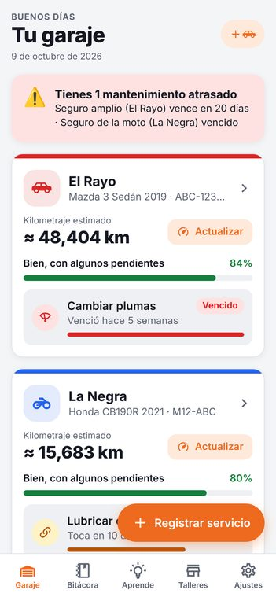
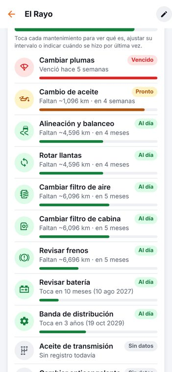
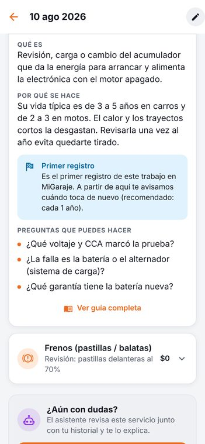
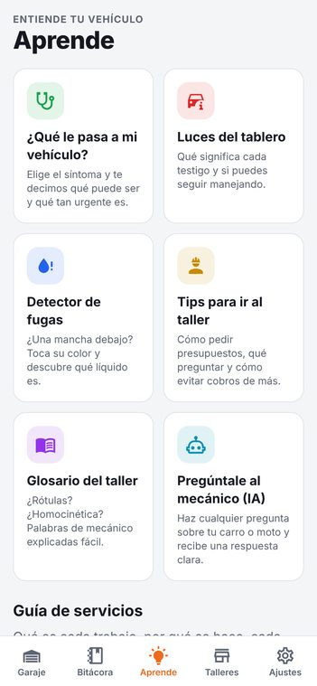
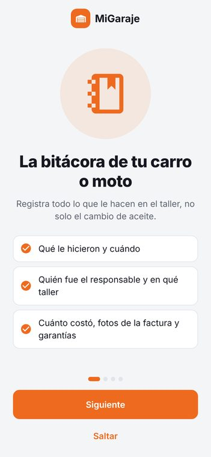
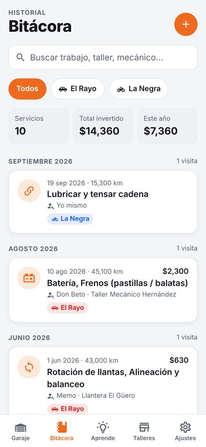
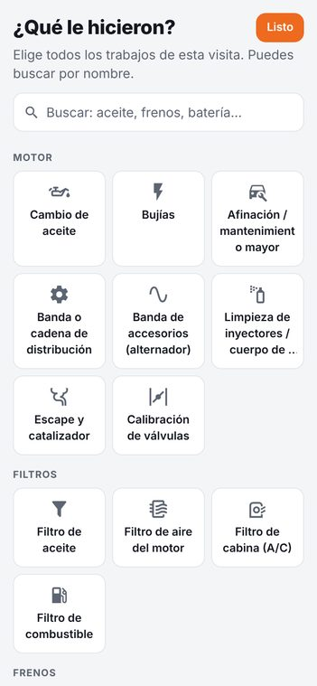
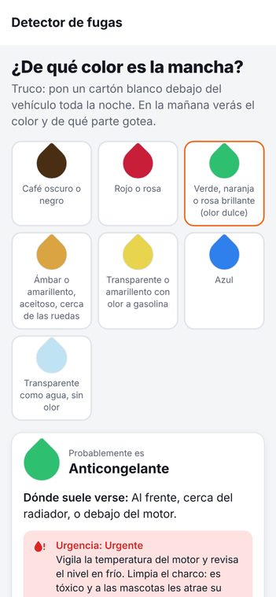

# 🚗🔧 MiGaraje

**La bitácora de tu carro o moto.** Registra todo lo que le hacen en el taller (no solo el cambio de aceite), entiende **qué** le hicieron y **por qué**, guarda **quién fue el responsable** y recibe **recordatorios** antes de que toque cada mantenimiento.

App para **iPhone y Android** hecha con [Expo](https://expo.dev) (React Native). Todo funciona sin internet y los datos se guardan en el teléfono.

| Inicio | Estado del vehículo | Servicio explicado | Aprende |
| --- | --- | --- | --- |
|  |  |  |  |

| Bienvenida | Bitácora | Elegir trabajos | Detector de fugas |
| --- | --- | --- | --- |
|  |  |  |  |

---

## ✨ Qué hace

### 📒 Bitácora completa de cada visita al taller
- **Qué le hicieron**: más de 30 tipos de trabajo (aceite, frenos, llantas, suspensión, batería, banda de distribución, clutch, cadena de moto, válvulas…) y varios por visita.
- **Cuándo y con cuántos km**.
- **Quién fue el responsable**: taller y mecánico (se van guardando para elegirlos rápido).
- **Por qué lo llevaste** y **qué te explicó el mecánico**.
- **Costos** por trabajo, mano de obra y total.
- **Garantía** (fecha y/o km) — la app te dice si sigue vigente y a quién reclamar.
- **Fotos** de la factura y de las piezas.
- **Calificación** del servicio para saber en qué taller confiar.

### 🧠 Te ayuda a entender
- Cada trabajo trae **qué es, por qué se hace, señales de que lo necesitas, qué pasa si no lo haces y preguntas para el mecánico**.
- **¿Se hizo a tiempo?** La app compara con el registro anterior y te avisa si algo se hizo **demasiado pronto** (posible cobro innecesario), a tiempo o tarde.
- **Comparación de costos** con la vez anterior ("costó 20% más").
- Sección **Aprende**:
  - 🩺 **¿Qué le pasa a mi vehículo?** — síntomas (chilla al frenar, se calienta, humo, no arranca…) con causas, urgencia y qué revisar.
  - 🚨 **Luces del tablero** — qué significa cada testigo y si puedes seguir manejando.
  - 💧 **Detector de fugas** — toca el color de la mancha y te dice qué líquido es.
  - 📖 **Glosario del taller** — rótulas, homocinética, cremallera… explicado fácil.
  - 🧰 **Tips para ir al taller** — presupuestos, piezas viejas, garantías.

### ⏰ Recordatorios inteligentes
- Calcula cuándo toca cada mantenimiento **por kilómetros o por tiempo (lo que llegue primero)**.
- **Estima tu kilometraje** de hoy con tu historial real (o con los km/mes que indiques).
- Usa el dato de la **calcomanía del aceite** si lo capturas.
- Notificaciones **una semana antes y el día que toca**, más avisos de **seguro, verificación, tenencia y licencia**.
- Recordatorio opcional para **actualizar el kilometraje**.
- **Salud del vehículo** en % y lista de "lo que toca pronto".

### 🎁 Extras
- 🚗 + 🏍️ **Varios vehículos** (carros y motos, gasolina, diésel, híbrido, eléctrico).
- 📄 **Historial en PDF** para compartir — ideal al **vender tu vehículo** (un historial completo aumenta su valor).
- 📊 **Gastos**: total, por año, por tipo de trabajo y **costo por km**.
- 💾 **Respaldo** para exportar/importar tus datos.
- 🌙 Modo oscuro, km o millas y la moneda que uses.
- 🤖 **Asistente con IA (opcional)**:
  - 📸 **Escanea la factura** del taller y llena el registro por ti.
  - 💬 **"Explícamelo"**: revisa un servicio junto con tu historial y te lo explica.
  - 👨‍🔧 **Pregúntale al mecánico**: chat sobre tu carro o moto.
  - Funciona con tu propia clave de [Anthropic](https://console.anthropic.com/settings/keys) (Claude); se guarda cifrada solo en tu teléfono.

---

## 📱 Probarla en tu celular (lo más rápido)

1. Instala **Node.js LTS** en tu computadora: <https://nodejs.org>
2. Instala la app **Expo Go** en tu celular ([iPhone](https://apps.apple.com/app/expo-go/id982107779) / [Android](https://play.google.com/store/apps/details?id=host.exp.exponent)).
3. En una terminal:

   ```bash
   cd migaraje
   npm install
   npx expo start
   ```

4. Escanea el código QR que aparece:
   - **iPhone**: con la app de Cámara.
   - **Android**: desde la app Expo Go.

   Tu computadora y tu celular deben estar en la **misma red Wi‑Fi**. Si no funciona, prueba `npx expo start --tunnel`.

5. En la bienvenida toca **"Ver con datos de ejemplo"** para explorar todo con un carro y una moto de muestra, o **"Agregar mi vehículo"** para empezar con los tuyos.

> **Nota sobre Expo Go:** es perfecto para probar. Las notificaciones locales funcionan, pero Expo Go tiene algunas limitaciones (sobre todo en Android). Para la experiencia completa, usa una *development build* o instala la app final (ver abajo).

---

## 🚀 Instalarla como app de verdad / publicarla

Se usa **EAS** (el servicio de compilación de Expo; no necesitas Mac ni Android Studio):

```bash
npm install -g eas-cli
eas login                      # crea una cuenta gratis en expo.dev
eas build:configure

# APK para instalar directo en Android (para ti y tu familia)
eas build -p android --profile preview

# Versión para las tiendas
eas build -p android --profile production
eas build -p ios --profile production

# Subir a las tiendas
eas submit -p android
eas submit -p ios
```

Para publicar necesitas una cuenta de **Google Play Console** (pago único de USD 25) y de **Apple Developer** (USD 99 al año). Los identificadores de la app ya están configurados en `app.json` como `com.jorgehdz94.migaraje` (cámbialos si quieres).

---

## 🧑‍💻 Para desarrolladores

```bash
npm test            # pruebas (lógica de mantenimiento, recordatorios, análisis, respaldos, IA simulada)
npm run lint        # ESLint
npm run typecheck   # TypeScript
npx expo start      # servidor de desarrollo
```

**Tecnologías:** Expo SDK 57 · React Native 0.86 · Expo Router · TypeScript · Zustand + AsyncStorage · expo-notifications · expo-image-picker · expo-print · expo-secure-store · SDK de Anthropic.

### Estructura

```
migaraje/
├── app.json                 # configuración de la app (nombre, íconos, permisos)
├── eas.json                 # perfiles de compilación
├── assets/images/           # ícono, splash, ícono de notificaciones
└── src/
    ├── app/                 # pantallas (cada archivo es una ruta de Expo Router)
    │   ├── (tabs)/          # Garaje, Bitácora, Aprende, Talleres, Ajustes
    │   ├── vehiculo/        # alta, detalle y edición de vehículos
    │   ├── servicio/        # registrar, ver (con explicaciones) y editar servicios
    │   ├── plan/            # cada recordatorio de mantenimiento
    │   ├── guia/            # guías, síntomas, luces, fugas, glosario, tips
    │   ├── taller/          # talleres y mecánicos
    │   ├── documento/       # seguro, verificación, licencia…
    │   └── ia/              # asistente con IA (opcional)
    ├── components/          # componentes visuales reutilizables y formularios
    ├── data/                # contenido educativo (servicios, síntomas, luces, glosario…)
    ├── logic/               # cálculos puros con pruebas: intervalos, km estimado, análisis, reportes
    ├── services/            # notificaciones, fotos, archivos/PDF, IA, retroalimentación
    └── store/               # estado global guardado en el teléfono
```

### Ideas para siguientes versiones
- ☁️ Sincronizar en la nube y compartir un vehículo con la familia.
- ⛽ Registro de cargas de gasolina y rendimiento (km/l).
- 🔌 Lectura de códigos de falla con un lector OBD2 Bluetooth.
- 🧾 Exportar a Excel y widgets en la pantalla de inicio.

---

> La información de la app es una guía general de referencia. Siempre manda el manual de tu vehículo y la revisión de un mecánico.
